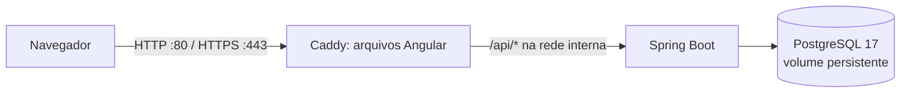
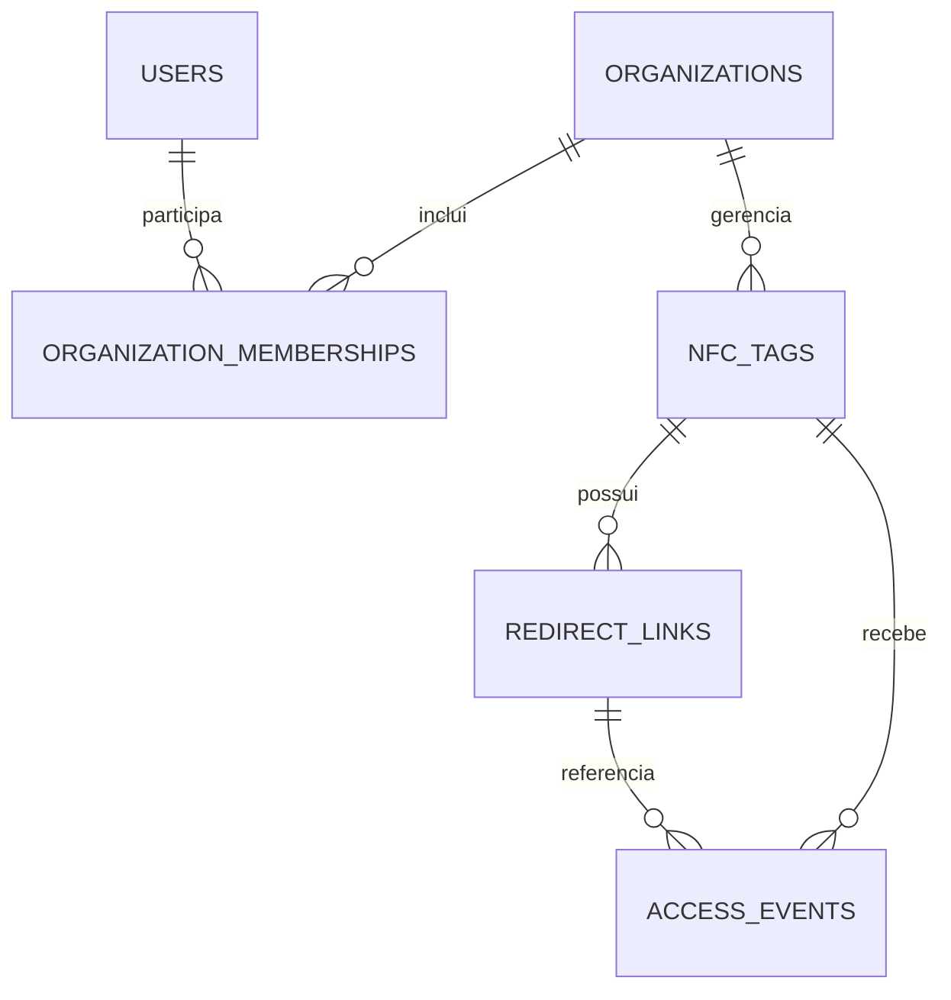

# NFC.APP — Arquitetura e execução



Somente o Caddy publica portas no host. O backend e o banco ficam na rede Docker privada.

## Modelo de dados inicial



A migração Flyway V2 cria essas tabelas. Um destino pode estar ativo por placa; eventos guardam placa, destino e horário, sem IP ou user-agent.

## Executar localmente

1. Configure `.env` (já criado; altere a senha se necessário).
2. Na raiz do repositório:

```sh
docker compose up -d --build
```

Frontend: http://localhost  
Status da API: http://localhost/api/status

## Comandos úteis

```sh
docker compose ps
docker compose logs -f
docker compose down
```

`down` mantém os dados do banco. Para apagá-los explicitamente: `docker compose down -v`.

## Produção

Configure `APP_DOMAIN` e `CADDY_DNS_API_TOKEN`, crie DNS para o domínio raiz e wildcard e execute:

```sh
docker compose -f compose.yml -f compose.prod.yml up -d --build
```

Wildcard HTTPS requer DNS-01 e um provedor/módulo DNS compatível no Caddy.
