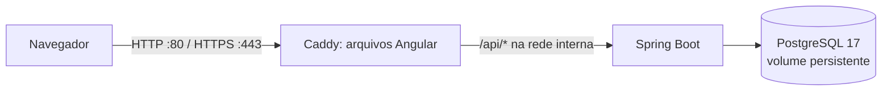
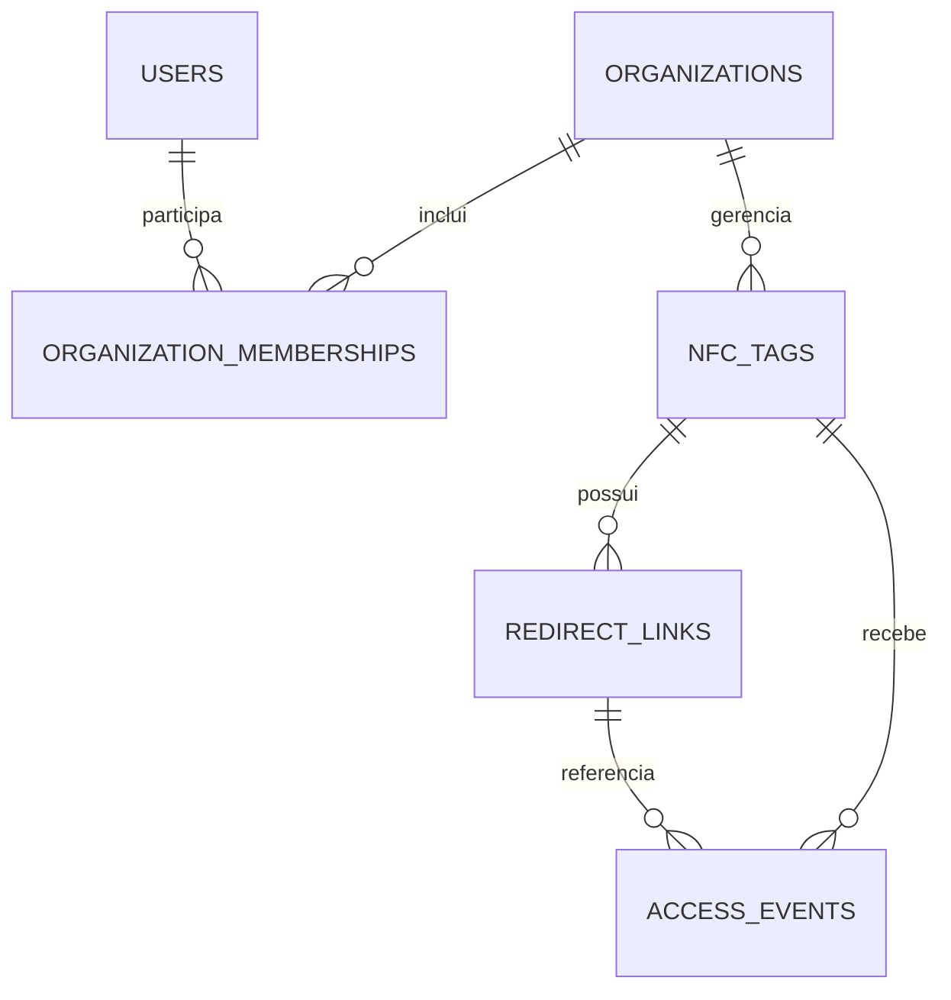

# NFC.APP — Arquitetura e execução



Somente o Caddy publica portas no host. O backend e o banco ficam na rede Docker privada.

## Modelo de dados inicial



A migração Flyway V2 cria essas tabelas. Um destino pode estar ativo por placa; eventos guardam placa, destino e horário, sem IP ou user-agent.

## Executar localmente

1. Configure `.env` (já criado; altere a senha se necessário).
2. Na raiz do repositório:

```sh
docker compose up -d --build
```

Frontend: http://localhost  
Status da API: http://localhost/api/status

## Autenticação Google (Firebase Authentication)

No Firebase Console, habilite o provedor **Google** em Authentication e adicione o domínio de produção em *Authorized domains* (`localhost` já vem autorizado). Configure `FIREBASE_API_KEY`, `FIREBASE_AUTH_DOMAIN`, `FIREBASE_PROJECT_ID` e `FIREBASE_APP_ID` no `.env`; o frontend lê esses valores públicos em `/firebase-config.json`, gerado na inicialização do contêiner.

O Angular abre o popup do Google via Firebase SDK e envia o ID token para `POST /api/auth/session`. O backend valida assinatura, emissor, audiência e e-mail Google verificado, cria a conta no primeiro acesso e abre uma sessão no servidor; o Firebase não mantém estado no navegador. Login e cadastro usam o mesmo fluxo; não há senha local. O navegador recebe apenas um cookie `HttpOnly`, `SameSite=Lax`; em produção `SESSION_COOKIE_SECURE=true` deve ser mantido.

## Comandos úteis

```sh
docker compose ps
docker compose logs -f
docker compose up -d --build frontend
docker compose restart frontend
docker compose down
```

Use `docker compose up -d --build frontend` após alterar o código ou as dependências do frontend; o build é incluído na imagem Docker. Use `docker compose restart frontend` somente para reiniciar o serviço sem reconstruir a imagem.

`down` mantém os dados do banco. Para apagá-los explicitamente: `docker compose down -v`.

## Produção

Configure `APP_DOMAIN` e `CADDY_DNS_API_TOKEN`, crie DNS para o domínio raiz e wildcard e execute:

```sh
docker compose -f compose.yml -f compose.prod.yml up -d --build
```

Wildcard HTTPS requer DNS-01 e um provedor/módulo DNS compatível no Caddy.
